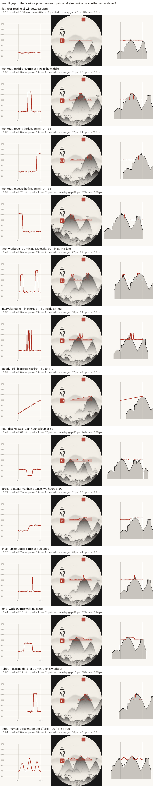

# Ink face fidelity: 2026-11-02 0851

How well the painted landscape (host + guest planes) shows the four-hour
heart-rate graph, per `scripts/fidelity_test.py`. Columns are the face's
time axis (0.36..0.80 of the width). See [README](README.md) for the metrics.

| Case | What | r | Peak off (min) | Peaks true / painted | Overlay gap (px) | True range (bpm) | Painted relief (px) |
|---|---|---|---|---|---|---|---|
| flat_rest | resting all window, 62 bpm | 0.15 | 106 | 0 / 1 | 47 | 3 | 98 |
| workout_middle | 40 min at 140 in the middle | 0.56 | 3 | 1 / 1 | 31 | 76 | 133 |
| workout_recent | the last 45 min at 135 | 0.65 | 8 | 1 / 1 | 57 | 71 | 205 |
| workout_oldest | the first 45 min at 135 | 0.59 | 20 | 1 / 1 | 32 | 72 | 135 |
| two_workouts | 30 min at 130 early, 30 min at 145 late | 0.49 | 5 | 2 / 2 | 27 | 82 | 132 |
| intervals | four 5-min efforts at 150 inside an hour | 0.36 | 3 | 2 / 1 | 38 | 64 | 113 |
| steady_climb | a slow rise from 60 to 110 | 0.97 | 0 | 1 / 1 | 87 | 49 | 187 |
| nap_dip | 75 awake, an hour asleep at 52 | 0.47 | 61 | 1 / 2 | 35 | 24 | 105 |
| stress_plateau | 70, then a tense two hours at 90 | 0.74 | 2 | 1 / 1 | 51 | 23 | 122 |
| short_spike | stairs: 5 min at 125 once | 0.25 | 7 | 1 / 1 | 48 | 41 | 126 |
| long_walk | 90 min walking at 98 | 0.41 | 15 | 1 / 1 | 32 | 32 | 114 |
| reboot_gap | no data for 90 min, then a workout | 0.65 | 17 | 1 / 1 | 15 | 69 | 133 |
| three_humps | three moderate efforts, 100 / 115 / 105 | 0.01 | 8 | 3 / 2 | 36 | 46 | 118 |

## Summary

- Mean r: 0.48 (1.00 = the skyline follows the data)
- Mean peak timing error: 20 min
- Peak count matches: 9 of 13 cases
- Mean overlay-to-ink gap: 41 px
- HR scale: 60 -> 100 bpm moves the host crest 27 px of 416

