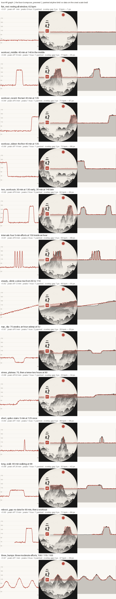

# Ink face fidelity: 2026-11-05 1059

How well the painted landscape (horizon + masses) shows the four-hour
heart-rate graph, per `scripts/fidelity_test.py`. Columns are the face's
time axis (the full width). See [README](README.md) for the metrics.

| Case | What | r | Peak off (min) | Peaks true / painted | Overlay gap (px) | True range (bpm) | Painted relief (px) |
|---|---|---|---|---|---|---|---|
| flat_rest | resting all window, 62 bpm | 0.01 | - | 0 / 0 | 2 | 3 | 1 |
| workout_middle | 40 min at 140 in the middle | 0.95 | 10 | 1 / 1 | 5 | 77 | 95 |
| workout_recent | the last 45 min at 135 | 0.99 | 0 | 1 / 1 | 2 | 71 | 87 |
| workout_oldest | the first 45 min at 135 | 0.99 | 14 | 1 / 1 | 2 | 72 | 88 |
| two_workouts | 30 min at 130 early, 30 min at 145 late | 0.96 | 8 | 2 / 2 | 5 | 82 | 99 |
| intervals | four 5-min efforts at 150 inside an hour | 0.61 | 8 | 2 / 1 | 14 | 69 | 98 |
| steady_climb | a slow rise from 60 to 110 | 0.92 | 12 | 1 / 1 | 7 | 49 | 55 |
| nap_dip | 75 awake, an hour asleep at 52 | 0.97 | 5 | 1 / 2 | 3 | 26 | 33 |
| stress_plateau | 70, then a tense two hours at 90 | 0.98 | 62 | 1 / 1 | 3 | 23 | 34 |
| short_spike | stairs: 5 min at 125 once | 0.60 | 1 | 1 / 1 | 6 | 48 | 68 |
| long_walk | 90 min walking at 98 | 0.98 | 26 | 1 / 1 | 2 | 32 | 42 |
| reboot_gap | no data for 90 min, then a workout | 0.95 | 13 | 1 / 1 | 6 | 71 | 86 |
| three_humps | three moderate efforts, 100 / 115 / 105 | 0.97 | 1 | 3 / 3 | 4 | 47 | 59 |

## Summary

- Mean r: 0.84 (1.00 = the skyline follows the data)
- Mean peak timing error: 13 min
- Peak count matches: 11 of 13 cases
- Mean overlay-to-ink gap: 5 px
- HR scale: 60 -> 100 bpm moves the host crest 46 px of 416

