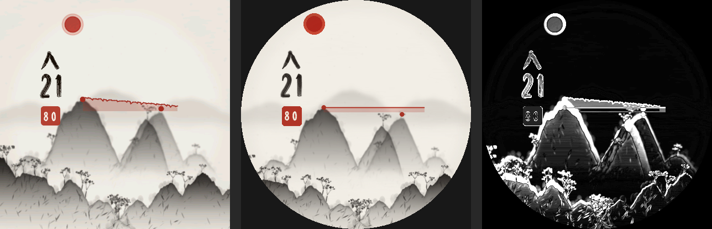

# Home verify 2026-10-30_0820

Written by `scripts/home-verify.ps1` on the PC with the Connect IQ SDK.
Read [COMPILER_FACTS](../language/COMPILER_FACTS.md) for what earlier runs proved.

- Commit: `bba831a Home verify tooling and compiler facts for machines without the SDK` (pulled (fast-forward only))
- Working tree: clean
- SDK: `connectiq-sdk-win-9.1.0-2026-03-09-6a872a80b`

## Builds (`monkeyc -w -l 2`)

| Project | Device | Result | Warnings | PRG bytes |
|---|---|---|---|---|
| japanese-ink-heartrate | fr265 | OK | 28 | 374492 |
| friend (wrist-diary) | fr265 | OK | 1 | 137788 |
| walk-probe | fr265 | OK | 2 | 107452 |
| walk-probe | fr265s | skipped: device files not installed | | |
| walk-probe | vivoactive6 | OK | 2 | 106684 |
| pet-hardware-probe | fr265 | OK | 6 | 108828 |
| pet-hardware-probe | fr265s | skipped: device files not installed | | |
| pet-hardware-probe | vivoactive6 | OK | 6 | 108060 |

## Offline tests

| Test | Result | Last line |
|---|---|---|
| test-backup-garmin-device.ps1 | pass | [pass] Garmin backup: full tree, empty/zero-byte files, manifest, SHA-256 tamper detection, partial failure, path safety |
| test-friend-chapters.ps1 | pass | [pass] Friend chapter behavior: isolated gesture, desk tail, HR-only, Back partial |
| test-friend-export.ps1 | pass | [pass] Friend export: compact round trip, 3371-byte full export, 4768-byte worst case, headerless parse, mixed-width sessions, format 3, archive |
| test-friend-walk.ps1 | pass | [pass] Friend walk flow: ready, immediate start, end prompt, resume, save/fail, Back, idempotent close |
| test-pet-model.ps1 | pass | [pass] Pet model: mood floor, no death at 90 days, warm reunion, 48 h pause, binge taper never zero, 03:00 start-day credit, split-invariant credit, one-miss grace, warmth never multiplies, monotonic stages, evolution gates |
| watch-tools.ps1 test | pass |   + Sports/Strength.fit / sport[0] / sport = training |

## Japanese Ink: simulator beside compose_preview.py



- Left: the simulator at 08:21 after a fresh push. Middle: `compose_preview.py --data <flat 80 bpm> --time 08:21`. Right: the difference inside the circle, brightened 4x.
- mean_abs_diff=12.3 over32_pct=10.6 (inside the circle; a smoke number, the data is not identical).
- The preview assumes the simulator's 12-hour clock and default night window (21-6).

## Compiler output (errors first, then unique warnings)

### japanese-ink-heartrate / fr265

```
WARNING: fr265: The launcher icon (30x30) isn't compatible with the specified launcher icon size of the device 'fr265' (60x60). The image will be scaled to the target size.
WARNING: fr265: watch-faces\japanese-ink-heartrate\source\JapaneseInkHeartrateScene.mc:157: Function return is untyped.
WARNING: fr265: watch-faces\japanese-ink-heartrate\source\JapaneseInkHeartrateScene.mc:54: Member '$.JapaneseInkHeartrateScene.mFar' is untyped.
WARNING: fr265: watch-faces\japanese-ink-heartrate\source\JapaneseInkHeartrateScene.mc:55: Member '$.JapaneseInkHeartrateScene.mHost' is untyped.
WARNING: fr265: watch-faces\japanese-ink-heartrate\source\JapaneseInkHeartrateScene.mc:56: Member '$.JapaneseInkHeartrateScene.mGuest' is untyped.
WARNING: fr265: watch-faces\japanese-ink-heartrate\source\JapaneseInkHeartrateScene.mc:57: Member '$.JapaneseInkHeartrateScene.mMist' is untyped.
WARNING: fr265: watch-faces\japanese-ink-heartrate\source\JapaneseInkHeartrateScene.mc:58: Member '$.JapaneseInkHeartrateScene.mMistLite' is untyped.
WARNING: fr265: watch-faces\japanese-ink-heartrate\source\JapaneseInkHeartrateScene.mc:59: Member '$.JapaneseInkHeartrateScene.mFgLeft' is untyped.
WARNING: fr265: watch-faces\japanese-ink-heartrate\source\JapaneseInkHeartrateScene.mc:60: Member '$.JapaneseInkHeartrateScene.mFgRight' is untyped.
WARNING: fr265: watch-faces\japanese-ink-heartrate\source\JapaneseInkHeartrateScene.mc:61: Member '$.JapaneseInkHeartrateScene.mPaperGrain' is untyped.
WARNING: fr265: watch-faces\japanese-ink-heartrate\source\JapaneseInkHeartrateScene.mc:638,12: Passing 'Any' as parameter 5 of poly type 'PolyType<$.Toybox.Graphics.BitmapReference or $.Toybox.Graphics.BufferedBitmap or $.Toybox.Graphics.BufferedBitmapReference or $.Toybox.WatchUi.BitmapResource>'.
WARNING: fr265: watch-faces\japanese-ink-heartrate\source\JapaneseInkHeartrateScene.mc:643,12: Passing 'Any' as parameter 5 of poly type 'PolyType<$.Toybox.Graphics.BitmapReference or $.Toybox.Graphics.BufferedBitmap or $.Toybox.Graphics.BufferedBitmapReference or $.Toybox.WatchUi.BitmapResource>'.
WARNING: fr265: watch-faces\japanese-ink-heartrate\source\JapaneseInkHeartrateScene.mc:653,12: Passing 'Any' as parameter 5 of poly type 'PolyType<$.Toybox.Graphics.BitmapReference or $.Toybox.Graphics.BufferedBitmap or $.Toybox.Graphics.BufferedBitmapReference or $.Toybox.WatchUi.BitmapResource>'.
WARNING: fr265: watch-faces\japanese-ink-heartrate\source\JapaneseInkHeartrateScene.mc:662,12: Passing 'Any' as parameter 5 of poly type 'PolyType<$.Toybox.Graphics.BitmapReference or $.Toybox.Graphics.BufferedBitmap or $.Toybox.Graphics.BufferedBitmapReference or $.Toybox.WatchUi.BitmapResource>'.
WARNING: fr265: watch-faces\japanese-ink-heartrate\source\JapaneseInkHeartrateScene.mc:667,12: Passing 'Any' as parameter 5 of poly type 'PolyType<$.Toybox.Graphics.BitmapReference or $.Toybox.Graphics.BufferedBitmap or $.Toybox.Graphics.BufferedBitmapReference or $.Toybox.WatchUi.BitmapResource>'.
WARNING: fr265: watch-faces\japanese-ink-heartrate\source\JapaneseInkHeartrateScene.mc:674,12: Passing 'Any' as parameter 5 of poly type 'PolyType<$.Toybox.Graphics.BitmapReference or $.Toybox.Graphics.BufferedBitmap or $.Toybox.Graphics.BufferedBitmapReference or $.Toybox.WatchUi.BitmapResource>'.
WARNING: fr265: watch-faces\japanese-ink-heartrate\source\JapaneseInkHeartrateScene.mc:679,12: Passing 'Any' as parameter 5 of poly type 'PolyType<$.Toybox.Graphics.BitmapReference or $.Toybox.Graphics.BufferedBitmap or $.Toybox.Graphics.BufferedBitmapReference or $.Toybox.WatchUi.BitmapResource>'.
WARNING: fr265: watch-faces\japanese-ink-heartrate\source\JapaneseInkHeartrateScene.mc:684,12: Passing 'Any' as parameter 5 of poly type 'PolyType<$.Toybox.Graphics.BitmapReference or $.Toybox.Graphics.BufferedBitmap or $.Toybox.Graphics.BufferedBitmapReference or $.Toybox.WatchUi.BitmapResource>'.
WARNING: fr265: watch-faces\japanese-ink-heartrate\source\JapaneseInkHeartrateScene.mc:810,12: Passing 'Any' as parameter 5 of poly type 'PolyType<$.Toybox.Graphics.BitmapReference or $.Toybox.Graphics.BufferedBitmap or $.Toybox.Graphics.BufferedBitmapReference or $.Toybox.WatchUi.BitmapResource>'.
WARNING: fr265: watch-faces\japanese-ink-heartrate\source\JapaneseInkHeartrateScene.mc:815,20: Passing 'Any' as parameter 3 of poly type 'PolyType<$.Toybox.Graphics.BitmapReference or $.Toybox.Graphics.BufferedBitmap or $.Toybox.Graphics.BufferedBitmapReference or $.Toybox.WatchUi.BitmapResource>'.
WARNING: fr265: watch-faces\japanese-ink-heartrate\source\JapaneseInkHeartrateScene.mc:840,12: Passing 'Any' as parameter 3 of poly type 'PolyType<$.Toybox.Graphics.BitmapReference or $.Toybox.Graphics.BufferedBitmap or $.Toybox.Graphics.BufferedBitmapReference or $.Toybox.WatchUi.BitmapResource>'.
WARNING: fr265: watch-faces\japanese-ink-heartrate\source\JapaneseInkHeartrateScene.mc:847,20: Passing 'Any' as parameter 3 of poly type 'PolyType<$.Toybox.Graphics.BitmapReference or $.Toybox.Graphics.BufferedBitmap or $.Toybox.Graphics.BufferedBitmapReference or $.Toybox.WatchUi.BitmapResource>'.
WARNING: fr265: watch-faces\japanese-ink-heartrate\source\JapaneseInkHeartrateScene.mc:873,12: Passing 'Any' as parameter 5 of poly type 'PolyType<$.Toybox.Graphics.BitmapReference or $.Toybox.Graphics.BufferedBitmap or $.Toybox.Graphics.BufferedBitmapReference or $.Toybox.WatchUi.BitmapResource>'.
WARNING: fr265: watch-faces\japanese-ink-heartrate\source\JapaneseInkHeartrateScene.mc:874,12: Passing 'Any' as parameter 5 of poly type 'PolyType<$.Toybox.Graphics.BitmapReference or $.Toybox.Graphics.BufferedBitmap or $.Toybox.Graphics.BufferedBitmapReference or $.Toybox.WatchUi.BitmapResource>'.
WARNING: fr265: watch-faces\japanese-ink-heartrate\source\JapaneseInkHeartrateScene.mc:879,20: Passing 'Any' as parameter 5 of poly type 'PolyType<$.Toybox.Graphics.BitmapReference or $.Toybox.Graphics.BufferedBitmap or $.Toybox.Graphics.BufferedBitmapReference or $.Toybox.WatchUi.BitmapResource>'.
WARNING: fr265: watch-faces\japanese-ink-heartrate\source\JapaneseInkHeartrateScene.mc:880,20: Passing 'Any' as parameter 5 of poly type 'PolyType<$.Toybox.Graphics.BitmapReference or $.Toybox.Graphics.BufferedBitmap or $.Toybox.Graphics.BufferedBitmapReference or $.Toybox.WatchUi.BitmapResource>'.
WARNING: fr265: watch-faces\japanese-ink-heartrate\source\JapaneseInkHeartrateScene.mc:908,12: Passing 'Any' as parameter 3 of poly type 'PolyType<$.Toybox.Graphics.BitmapReference or $.Toybox.Graphics.BufferedBitmap or $.Toybox.Graphics.BufferedBitmapReference or $.Toybox.WatchUi.BitmapResource>'.
WARNING: fr265: watch-faces\japanese-ink-heartrate\source\JapaneseInkHeartrateScene.mc:945,12: Passing 'Any' as parameter 3 of poly type 'PolyType<$.Toybox.Graphics.BitmapReference or $.Toybox.Graphics.BufferedBitmap or $.Toybox.Graphics.BufferedBitmapReference or $.Toybox.WatchUi.BitmapResource>'.
```

### friend (wrist-diary) / fr265

```
WARNING: fr265: The launcher icon (30x30) isn't compatible with the specified launcher icon size of the device 'fr265' (60x60). The image will be scaled to the target size.
```

### walk-probe / fr265

```
WARNING: fr265: The launcher icon (30x30) isn't compatible with the specified launcher icon size of the device 'fr265' (60x60). The image will be scaled to the target size.
WARNING: garmin-pet\probes\walk\manifest.xml: Invalid device id found in the application manifest: 'fr265s'.
```

### walk-probe / vivoactive6

```
WARNING: garmin-pet\probes\walk\manifest.xml: Invalid device id found in the application manifest: 'fr265s'.
WARNING: vivoactive6: The launcher icon (30x30) isn't compatible with the specified launcher icon size of the device 'vivoactive6' (54x54). The image will be scaled to the target size.
```

### pet-hardware-probe / fr265

```
WARNING: fr265: garmin-pet\probes\hardware\source\PetHardwareProbeView.mc:304,16: Statement is not reachable.
WARNING: fr265: garmin-pet\probes\hardware\source\PetHardwareProbeView.mc:333,20: Statement is not reachable.
WARNING: fr265: garmin-pet\probes\hardware\source\PetHardwareProbeView.mc:385,16: Cannot find symbol ':format' on type 'Null'.
WARNING: fr265: garmin-pet\probes\hardware\source\PetHardwareProbeView.mc:388,16: Cannot find symbol ':format' on type 'Null'.
WARNING: fr265: The launcher icon (30x30) isn't compatible with the specified launcher icon size of the device 'fr265' (60x60). The image will be scaled to the target size.
WARNING: garmin-pet\probes\hardware\manifest.xml: Invalid device id found in the application manifest: 'fr265s'.
```

### pet-hardware-probe / vivoactive6

```
WARNING: garmin-pet\probes\hardware\manifest.xml: Invalid device id found in the application manifest: 'fr265s'.
WARNING: vivoactive6: garmin-pet\probes\hardware\source\PetHardwareProbeView.mc:304,16: Statement is not reachable.
WARNING: vivoactive6: garmin-pet\probes\hardware\source\PetHardwareProbeView.mc:333,20: Statement is not reachable.
WARNING: vivoactive6: garmin-pet\probes\hardware\source\PetHardwareProbeView.mc:385,16: Cannot find symbol ':format' on type 'Null'.
WARNING: vivoactive6: garmin-pet\probes\hardware\source\PetHardwareProbeView.mc:388,16: Cannot find symbol ':format' on type 'Null'.
WARNING: vivoactive6: The launcher icon (30x30) isn't compatible with the specified launcher icon size of the device 'vivoactive6' (54x54). The image will be scaled to the target size.
```

